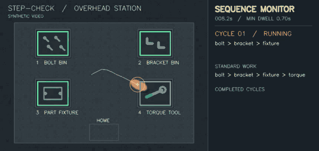

# step-check

`step-check` is a Python CLI that checks standard work from overhead workstation
video. The demo expects four steps in order: bolt bin, bracket bin, part fixture,
and torque tool. It reports each cycle's observed sequence, cycle time, and
PASS/FAIL verdict with a reason.



The GIF shows the end of each cycle. The generated MP4 contains the full run.

## Quickstart

Use Python 3.10 or newer. From the repository root:

```sh
python -m pip install -r requirements.txt
python generate.py
python step_check.py out/synthetic.mp4 --truth out/truth.json
```

The generator writes `out/synthetic.mp4` and `out/truth.json`. The verifier writes
`out/annotated.mp4` and `out/report.json`. Use `--out` on either command to choose an
output directory or `--seed` on the generator to vary the synthetic motion,
dwell lengths, and image noise. The verifier takes the video as input.
`--truth` adds evaluation to the report and console output.

## How it works

- OpenCV generates a fixed overhead scene with four work zones and a separate
  home position. A skin-tone ellipse follows a scripted path with motion blur,
  jitter, lighting flicker, and pixel noise. The script records the ground-truth
  cycle boundaries and labeled visits directly from the programmed motion.
- HSV thresholding and morphological cleanup isolate hand candidates. The
  tracker associates a nearby contour centroid with the previous position
  and smooths it before testing zone membership.
- A smaller entry region, a larger exit region, and a two-frame exit grace
  period reduce boundary chatter. Only observed in-zone frames count toward
  the 0.70-second dwell minimum. Visits from 0.20 seconds up to the minimum
  surface as short dwells if the corresponding step is missing.
- The verifier detects a departure from home and a sustained return to home,
  then compares the accepted steps with the station template. It measures cycle
  time from departure to the tentative return once that return is confirmed.
  The video overlay shows the track, active dwell, sequence, and verdicts.

## Recorded run

Output from the default seed (17) on Python 3.13, OpenCV 4.14.0, and NumPy 2.5.1:

```text
Cycle 01  PASS   9.35s  bolt > bracket > fixture > torque | standard work matched
Cycle 02  FAIL   7.15s  bolt > fixture > torque | missing bracket
Cycle 03  FAIL   8.80s  bracket > bolt > fixture > torque | out of order: expected bolt first, saw bracket
Cycle 04  FAIL   8.35s  bolt > bracket > torque | fixture dwell 0.45s < 0.70s
Events: precision 100.0%, recall 100.0% (TP=14, FP=0, FN=0)
Cycle accuracy: 100.0% (4/4) | reason codes 4/4
Wrote out\annotated.mp4 and out\report.json
```

Evaluation pairs each predicted cycle with at most one ground-truth cycle at
0.50 temporal intersection over union (IoU) or higher. Within paired cycles,
accepted visits match one-to-one by step name at 0.30 temporal IoU or higher.
The event metrics count qualified visits, including visits in failed cycles.
Verdict accuracy counts unmatched cycles as errors. The fixture's measured
dwell includes frames entering and leaving its zone.

## Limitations

These results cover four scripted cycles in one synthetic scene. The verifier
assumes a fixed camera, one visible hand, known zone coordinates, and a home
position between cycles. A zone dwell is a proxy for an action. Checking
fastening or torque would require evidence of tool use or a tool signal.
Real lines would need learned hand and tool detectors (for example, YOLO on
labeled production frames), pose estimation where it helps identify actions,
occlusion handling, multi-camera views where needed, and per-station templates
validated on real operator footage.

I built this as a small extension of my work training YOLO and RF-DETR detectors
on Roboflow-labeled data and building a RealSense depth-camera vision pipeline
for a robot arm. - Muhammad Abdulrehman
